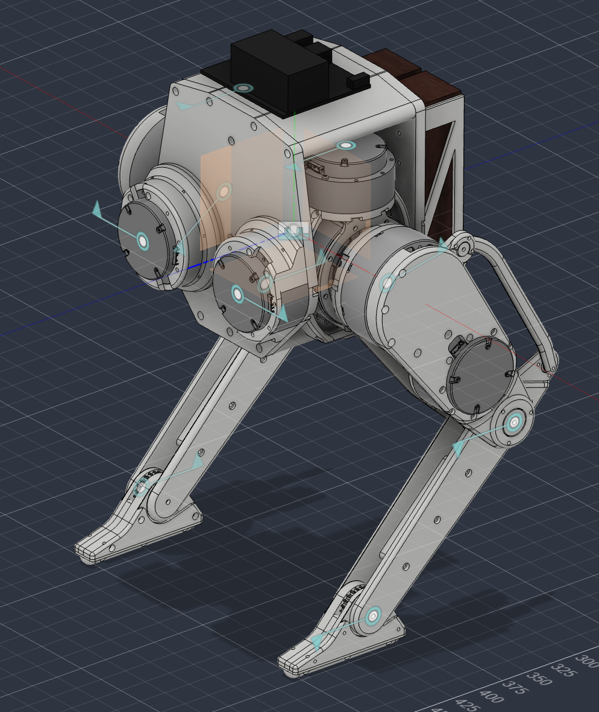

# Live Fusion validation

These artifacts reproduce the live Autodesk Fusion checks used after
[ACDC4Robot/Fusion360#17](https://github.com/ACDC4Robot/Fusion360/pull/17)
was merged. They target upstream `main@f1152d7` and the versioned
`fusion_props/v1` data contract.

## Files

- `acdc_nested_fixture.f3d` — public three-link synthetic design.
- `create_fixture.py` — regenerates the fixture with the Fusion API.
- `fusion_dump.py` — dumps the active design to `~/fusion_props.json`.
- `fusion_props.schema.json` — JSON Schema 2020-12 contract.

All values in the dump use SI units. Link inertia is about the center of mass
and aligned with Fusion world axes. Every body in a link-owned subtree is also
queried independently through an assembly-context BRep proxy, so body sums are
an independent check on occurrence-level physical properties.

## Fixture contents

The fixture contains:

- a `base_link` occurrence rotated +90 degrees around X;
- an asymmetric base body so CoM signs and inertia-axis swaps are observable;
- a nested, hidden `hidden_payload_box` below the root link;
- two occurrences of the same `arm_link` component;
- two rigid as-built joints, for three exported links and two joints.

To regenerate it, add this directory in Fusion's **Scripts and Add-Ins** dialog
and run `create_fixture.py`. Then run `fusion_dump.py` with the generated design
active. Export URDF with ACDC4Robot to a clean directory. For the MJCF
fail-closed check, select a second empty directory and confirm that preflight
rejects the nested design before any file is written.

## Issue #18 result

The Linux comparison places URDF inertials in world coordinates using zero-pose
FK and compares them with the Fusion dump. Thresholds are 1% mass, 0.5 mm CoM,
and 5% inertia.

| link | build | mass error | CoM error | inertia error | result |
| --- | --- | ---: | ---: | ---: | --- |
| `arm_link_1` | `main@f1152d7` | 0.00% | 0.000 mm | 0.00% | PASS |
| `arm_link_2` | `main@f1152d7` | 0.00% | 0.000 mm | 0.00% | PASS |
| `base_link` (root) | `main@f1152d7` | 0.00% | 63.722 mm | 42.50% | **FAIL** |
| `arm_link_1` | issue #18 fix | 0.00% | 0.000 mm | 0.00% | PASS |
| `arm_link_2` | issue #18 fix | 0.00% | 0.000 mm | 0.00% | PASS |
| `base_link` (root) | issue #18 fix | 0.00% | 0.000 mm | 0.00% | PASS |

The whole-assembly CoM error falls from 34.312 mm to 0.000 mm. Joint origins
remain at 0.000 mm error. The separate visibility-policy check shows that the
hidden payload is included in both physical mass and the exported STL: the
base is 70 cm3 for all bodies versus 64 cm3 for visible bodies only.

## PR #17 live follow-up

The private biped itself is not published. Its numeric results on
`main@f1152d7` are:



The screenshot is public to show the scale and nested mechanical structure of
the test assembly; the source Fusion design and exported meshes remain private.

- URDF structure: 12 links, 11 joints, one connected tree.
- Joint discovery: 11 records, 11 unique API objects, 0 duplicates.
- Mass ownership: all 12 occurrence masses equal their owned-body sums; no body
  is owned twice; URDF and Fusion total mass both equal 14.5832 kg.
- Inertial placement: 9 of 12 links fail; root error is 90.748 mm / 19.52%,
  worst CoM error is 415.013 mm, and worst inertia error is 95.38%.
- Joint placement: 8 of 11 joints fail the world-frame origin/axis check.
- MJCF: preflight fails closed with 23 diagnostics and writes 0 files.

The public fixture's MJCF preflight gives the more specific diagnostic below
and also writes 0 files:

```text
base_link:1 contains nested occurrences; flatten the robot assembly before MJCF export.
```

These failures are reported deliberately: the live run validates the new
identity-based link/joint discovery and mass ownership, but it does not support
a claim of general nested URDF or MJCF correctness yet.
